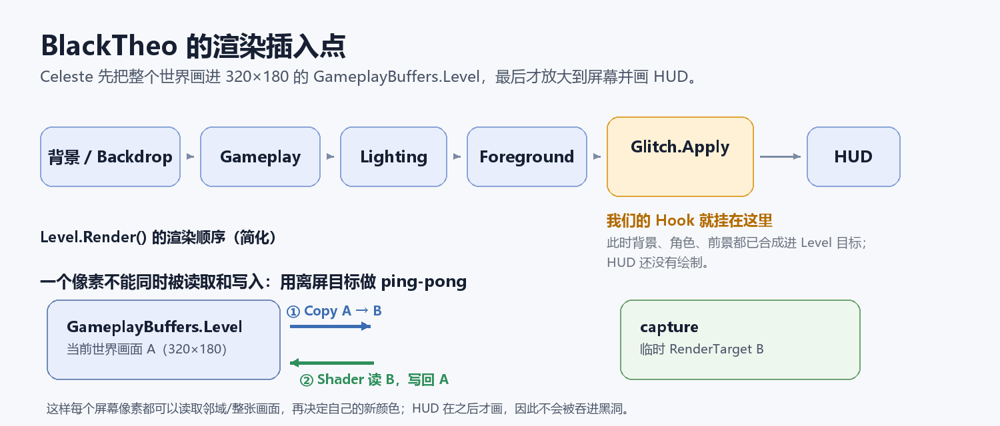

# BlackTheo 实现原理讲解

> 给想学习“游戏后处理 + 屏幕空间折射 + 简单光线追踪”的同学。
>
> 目标不是在 Celeste 里做一个物理精确的黑洞模拟，而是做一个**视觉上可信、实时可跑、能正确跟随 Theo 生命周期**的黑洞效果。本文会解释它为什么这样设计，以及哪些地方是物理近似、哪些地方是美术取舍。



## 代码地图（读代码时对照）

| 内容 | 位置 |
|---|---|
| 整体渲染入口 | [BlackHoleRenderer.Render](../src/BlackTheo/BlackHoleRenderer.cs#L65) |
| Ping-pong 与 shader 参数 | [ApplyHole](../src/BlackTheo/BlackHoleRenderer.cs#L112)、[SetGlobalParameters](../src/BlackTheo/BlackHoleRenderer.cs#L266) |
| Theo 收集、死亡过滤、持有上移 | [CollectHoles](../src/BlackTheo/BlackHoleRenderer.cs#L148) |
| 隐藏 Sprite / 管理可视状态 | [BlackHoleComponent](../src/BlackTheo/BlackHoleComponent.cs#L57) |
| Per-Theo 组件配置 | [BlackHoleComponent](../src/BlackTheo/BlackHoleComponent.cs) |
| 全局选项、颜色调色板 | [BlackHoleConfiguration](../src/BlackTheo/BlackHoleConfiguration.cs#L120) |
| Hook 点 | [Glitch_Apply](../src/BlackTheo/BlackTheoModule.cs#L66) |
| 吸积盘颜色与噪声 | [diskShade](../src/BlackHole.fx#L75) |
| 事件视界彩色噪点 | [horizonSpecks](../src/BlackHole.fx#L101) |
| 光线加速度 | [LensAccel](../src/BlackHole.fx#L132) |
| 像素 shader 主流程 | [PS](../src/BlackHole.fx#L138) |
| 光线积分与盘面交点 | [光线循环](../src/BlackHole.fx#L188) |
| 屏幕空间透镜 | [透镜位移](../src/BlackHole.fx#L259) |
| fxc 替代工具 | [EffectCompiler](../tools/EffectCompiler/Program.cs) |
| 构建/部署 | [build.ps1](../build.ps1) |

> 文档按 **1.1.0** 描述：事件视界 8px、透镜半径 50px、六种调色板、相机约 10° 仰角 + 18° 屏幕滚转。
>
> **1.1.0 的可调控项**：引力透镜幅度 `Off / Low / Medium / High`、吸积盘颜色、Doppler 开关；每个 Theo 通过 `BlackHoleComponent` 读取/覆盖这些值；事件视界内部新增少量带调色板颜色的漂浮像素点。

---

## 0. 一分钟版本

如果你只想先抓住主线：

1. **隐藏原视觉**：给 `TheoCrystal` 加一个 `BlackHoleComponent`，由它关掉 `Sprite`、把 `VertexLight` 的 alpha 设为 0；禁用/失败时再恢复。
2. **选后处理点**：Hook `Glitch.Apply`，这发生在这帧世界画面已经合成、HUD 还没画的时候。
3. **解决读写冲突**：把 `GameplayBuffers.Level` 复制到一个临时 RenderTarget，再把临时目标透过 shader 画回 `Level`。
4. **做吸积盘**：在 shader 里对每个像素积分 220 步光线，记录光线和 `y=0` 吸积盘平面的交点。近侧交点形成横带，远侧交点被引力弯到上下形成弧。
5. **做屏幕扭曲**：对逃逸光线，用最终方向减去初始方向得到偏折，再按 `(H/r)^2.2` 衰减，把位移限制在当前强度档位的 cap 内。
6. **做生命周期**：每帧从 `Level.Tracker` 重新取 Theo，按摄像机算屏幕位置；每帧读取组件/全局设置，死亡、重生、切板都不缓存旧状态。

下面的章节会把每一步展开。

---

## 1. 先把问题拆开

“把 Theo 换成一个黑洞”听起来像换贴图，实际上包含五个独立问题：

1. **原视觉怎么隐藏？**
   Theo 的 `Sprite` 和 `VertexLight` 要关掉，否则会和黑洞重叠。

2. **黑洞怎么跟随 Theo？**
   每帧从当前 `Level` 里找到所有 `TheoCrystal`，把世界坐标转换成屏幕坐标。

3. **事件视界怎么画？**
   在 Theo 的屏幕位置画一个纯黑圆盘；圆盘内部不能透出场景。

4. **屏幕像素怎么扭曲？**
   在游戏画面已经合成后，读取整张画面，按每个像素到黑洞的距离改变采样位置，再写回去。

5. **吸积盘怎么像“真的”？**
   不能贴一个椭圆。需要模拟光线绕过黑洞、从不同位置穿过吸积盘平面，才能得到“近侧横带 + 远侧上下弧”的结构。

最终效果是：

```text
       远侧盘面被弯到上方
          ╭─────────╮
       ╭──╯         ╰──╮
      │   事件视界/阴影  │
       ╰──╮  近侧细带  ╭──╯
          ╰─────────╯
       远侧盘面被弯到下方
```

---

## 2. Celeste 的渲染管线：为什么 Hook `Glitch.Apply`

Celeste 的世界不是直接画到屏幕上的，而是先画进一个 **320×180 的 RenderTarget**（`GameplayBuffers.Level`），最后再按窗口大小放大，并叠加 HUD。

一个简化的 `Level.Render()` 顺序：

```text
背景 Backdrop
  → GameplayRenderer（角色、实体）
  → Lighting
  → Bloom
  → Foreground
  → Glitch.Apply          ← 我们在这里做后处理
  → SetRenderTarget(null)
  → SubHUD
  → HUD
```

为什么选 `Glitch.Apply`？

- 它执行时，背景、角色、光效、前景都已经合成到 `GameplayBuffers.Level`。
- 它执行时，HUD 还没画，所以黑洞不会把血条、体力条也吞掉。
- 它接受 `VirtualRenderTarget source`，正好就是当前世界画面。

Hook 代码在 `src/BlackTheo/BlackTheoModule.cs`：

```csharp
public override void Load()
{
    On.Celeste.Glitch.Apply += Glitch_Apply;
    On.Celeste.TheoCrystal.ctor_Vector2 += TheoCrystal_ctor;
}

private static void Glitch_Apply(
    On.Celeste.Glitch.orig_Apply orig,
    VirtualRenderTarget source,
    float timer, float seed, float amplitude)
{
    orig(source, timer, seed, amplitude);
    BlackHoleRenderer.Render(source);
}
```

> `On.Celeste` 是 Everest 用的 MonoMod hook 命名空间。`orig` 是原方法，先调用它，保证原版 glitch 效果仍然正常。

一个容易犯的错误是把 hook 挂在 `Level.Render` 的 **postfix**：那时 HUD 已经画完了；或者挂在 **prefix**：那时场景还没画完。`Glitch.Apply` 这个插入点是“世界已完成、HUD 未开始”的窗口。

---

## 3. 为什么需要两个 RenderTarget

屏幕空间后处理有一个硬限制：**同一个 RenderTarget 不能一边被采样、一边被写入**。否则 GPU 不知道你读到的是旧内容还是新内容，会出现未定义行为。

所以采用 ping-pong：

```text
GameplayBuffers.Level（A）
        │
        │ ① 原样 copy
        ▼
    capture（B）
        │
        │ ② 用 shader 把 B 采样并画回 A
        ▼
GameplayBuffers.Level（A，新画面）
```

对应 C#（`BlackHoleRenderer.ApplyPass`）：

```csharp
// 1. 把当前世界画面复制到 capture
device.SetRenderTarget(capture);
device.Clear(Color.Black);
Draw.SpriteBatch.Begin(..., BlendState.Opaque, SamplerState.PointClamp, ...);
Draw.SpriteBatch.Draw(sourceTarget, Vector2.Zero, Color.White);
Draw.SpriteBatch.End();

// 2. 把 capture 通过黑洞 shader 画回 Level
device.SetRenderTarget(sourceTarget);
device.Clear(Color.Black);
Draw.SpriteBatch.Begin(..., effect);
Draw.SpriteBatch.Draw(capture, Vector2.Zero, Color.White);
Draw.SpriteBatch.End();
```

`capture` 是 `RenderTarget2D`，尺寸和 `GameplayBuffers.Level` 一样（320×180）。如果设备丢失或尺寸变化，`EnsureResources` 会重新创建它。

---

## 4. 坐标系统和顶点变换

### 4.1 两种坐标

后处理 shader 里有两个容易混的坐标：

- **UV**：SpriteBatch 画全屏 quad 时传入的 `0..1` 纹理坐标。
- **像素坐标**：`pixel = uv * ScreenSize`，范围 `0..320, 0..180`。

黑洞参数 `Hole`：

```hlsl
float4 Hole;
// xy = 黑洞中心的屏幕像素坐标
// z  = 事件视界/阴影半径（像素）
// w  = 透镜影响半径（像素）
```

C# 计算中心（`CollectHoles`）：

```csharp
Vector2 screenCenter = theo.Center - level.Camera.Position;
```

- `theo.Center` 是世界坐标（碰撞盒中心）。
- `level.Camera.Position` 是摄像机左上角世界坐标。
- 相减后就是 320×180 画面里的像素坐标。

因为后处理发生在 `GameplayBuffers.Level` 上，这里不需要再乘摄像机矩阵、缩放矩阵或窗口矩阵。**这是选 `Glitch.Apply` 的另一个好处**：世界已经烘焙成固定分辨率。

### 4.2 FNA 的自定义 Effect 不会自动应用矩阵

用 SpriteBatch + 自定义 Effect 时，FNA 不会像默认 SpriteEffect 那样自动设置 `MatrixTransform`。所以 C# 手动设置：

```csharp
effect.Parameters["MatrixTransform"].SetValue(
    Matrix.CreateScale(2f / width, -2f / height, 1f) *
    Matrix.CreateTranslation(-1f, 1f, 0f));
```

顶点 shader：

```hlsl
void SpriteVertexShader(
    inout float4 color : COLOR0,
    inout float2 texCoord : TEXCOORD0,
    inout float4 position : SV_Position)
{
    position = mul(position, MatrixTransform);
}
```

这行矩阵把像素坐标映射到裁剪空间：

- x：`0 → -1`，`width → +1`
- y：`0 → +1`，`height → -1`（因为屏幕 y 向下）

如果不设置矩阵，SpriteBatch 画出来的 quad 会跑到屏幕外，或者只有一小块。

---

## 5. 吸积盘为什么不能是椭圆

看参考图 `screen6`（真实的侧视黑洞吸积盘）：

- 中间是黑的；
- 上下有很厚的亮弧；
- 中间有一条很细的亮带横穿；
- 亮带和上下弧不是同一个“椭圆描边”。

原因是**引力透镜把吸积盘的不同部分映射到了不同位置**：

1. **近侧**吸积盘在黑洞前方，光线几乎直线到达相机，所以看起来是一条细带，从黑洞前面横穿。
2. **远侧**吸积盘在黑洞后方，它的光线要绕过黑洞才能到达相机；绕到上方和下方的光分别形成上下两道弧。
3. 在临界曲线附近，光线会绕黑洞很多圈，形成很细的**光子环**。

所以只画一个椭圆环，最多只能得到“一个甜甜圈”，不会得到“上弧 + 下弧 + 横带”的层叠结构。

BlackTheo 的做法：

- 在 3D 中放一个薄盘：平面 `y = 0`，半径范围 `2.0 .. 10.5`（单位取黑洞半径 `r_s = 1`）。
- 相机位于盘面上方一点：`(0, 11.0, -59.8)`，看向原点。
- 对屏幕上的每个像素，从相机发一条光线，在黑洞引力场中积分 220 步。
- 记录光线穿过 `y = 0` 平面的交点，最多 3 个。
- 用这些交点决定吸积盘的颜色。

这就是为什么它看起来像真的侧视盘，而不是椭圆。

---

## 6. 光线积分：代码在算什么

### 6.1 为什么不直接用牛顿万有引力

光没有静止质量，不能简单地用 `F = GMm/r²`。这里用的是 Schwarzschild 黑洞附近**光子轨道**的一个常用近似：

```hlsl
h2 = dot(cross(pos, v), cross(pos, v));
a = -1.5 * h2 * pos / (r2 * r2 * sqrt(r2));
```

其中：

- `pos` 是光线当前位置；
- `v` 是光线方向；
- `r2 = dot(pos, pos)`；
- `h = cross(pos, v)` 可以理解为“角动量”；
- `h2` 在中心力场中近似守恒；
- 加速度指向黑洞，大小随 `1/r^5` 增长。

这个形式来自把光子测地线方程投影到笛卡尔坐标后的有效中心力模型。它不是完整的 Kerr 度规，也不考虑黑洞自转，但足以产生**光线弯曲、临界曲线和光子环**的视觉特征。

### 6.2 起点、方向和 FOV 标定

每个屏幕像素对应一条光线：

```hlsl
float fovScale = 9.6 / shadowRadius;

float2 uvWin = (pixel - Hole.xy) / ScreenSize.y;
uvWin.y = -uvWin.y;
float2 uvw = uvWin * fovScale;

float3 fw = normalize(target - camera);
float3 rt = normalize(cross(fw, up));
float3 up = cross(rt, fw);

// 屏幕滚转：让吸积盘倾斜，而不是水平一条线
float roll = 0.32;
float3 rtRolled = rt * cos(roll) + up * sin(roll);
float3 upRolled = up * cos(roll) - rt * sin(roll);

float3 rd0 = normalize(fw * 1.2 + uvw.x * rtRolled + uvw.y * upRolled);
```

几个注意点：

- `ScreenSize.y` 而不是 `ScreenSize.x`：保持纵横比；320×180 的画面里，垂直方向是统一的尺度。
- `uvWin.y = -uvWin.y`：屏幕 y 向下，相机坐标 y 向上。
- `fovScale = 9.6 / shadowRadius`：这是一个**标定值**，不是物理常数。它让“临界撞击参数 `b_c = 2.598`”在 320×180 上恰好对应想要的阴影半径。`9.6` 是在这个相机/FOV 下测出来的像素值。
- `roll`：屏幕空间滚转，让盘面斜过来。注意黑洞阴影本身是各向同性的，旋转只改变盘和光线在画面上的方向。

### 6.3 积分循环

```hlsl
float3 pos = camera;
float3 v = rd0;
float3 hv = cross(pos, v);
float h2 = dot(hv, hv);

for (int i = 0; i < 220; i++)
{
    float r = length(pos);

    if (r < 1.0) { captured = 1.0; break; }            // 落入事件视界
    if (r > 90.0 && dot(pos, v) > 0.0) break;          // 逃逸

    float dt = 0.07 + 0.07 * clamp(r - 1.0, 0.0, 8.0);

    v += LensAccel(pos, h2) * dt;
    float3 prevP = pos;
    pos += v * dt;

    // 光线穿过 y=0 盘面？
    if (pos.y * prevP.y < 0.0)
    {
        float f = prevP.y / (prevP.y - pos.y);
        float3 hit = lerp(prevP, pos, f);
        ...
    }
}
```

这里的积分器是“半隐式 Euler / 类似 kick-drift”的形式：

1. 先根据当前位置算加速度；
2. 更新速度；
3. 更新位置。

步长 `dt` 随 `r` 增大而增大：

- 靠近黑洞时步长小，避免穿模；
- 远处步长大，节省循环次数。

起始点还加了随机抖动：

```hlsl
pos += v * (hash21(pixel) * 0.11);
```

这是为了打散步进造成的同心环状锯齿（banding），属于常见的 ray marching 抖动技巧。

> 220 步是性能和视觉的折中。步数太少会漏掉靠近光子球多次绕行的光线；步数太多在 320×180 上没必要，也会增加 GPU 负担。

---

## 7. 盘面交点如何变成图像

### 7.1 符号变化检测

盘面是 `y = 0`。光线从 `prevP` 走到 `pos`，如果：

```hlsl
pos.y * prevP.y < 0.0
```

说明它穿过了盘面。用线性插值求交点：

```hlsl
float f = prevP.y / (prevP.y - pos.y);
float3 hit = lerp(prevP, pos, f);
```

然后只接受落在吸积盘半径范围内的交点：

```hlsl
float hr = length(hit.xz);
if (hr > 2.0 && hr < 10.5)
{
    float4 data = float4(hr, atan2(hit.z, hit.x), abs(normalize(v).y), 1.0);
    // 记录 hit0 / hit1 / hit2
}
```

最多记录三个交点。为什么是三个？

- 近侧、远侧、以及绕黑洞一圈后再次穿盘，可能产生多个像；
- 三个已经能表现“上弧 + 下弧 + 横带”；
- 更多交点对 320×180 的收益很小。

### 7.2 近侧、远侧和遮挡

交点按光线前进顺序保存：

- `hit0` 是离相机最近的交点；
- `hit1` 是第二个；
- `hit2` 是第三个。

合成时：

```hlsl
diskCol += diskShade(hit0.x, hit0.y, time) * trans;
trans *= 0.52;
diskCol += diskShade(hit1.x, hit1.y, time) * trans;
trans *= 0.52;
...
```

`trans` 是透射率，每穿过一层盘减小一次。这样近侧盘会遮住一部分远侧盘，形成层次；同时又不是完全不透明，保留了后面的光。

> 这是视觉近似，不是严格的辐射转移。真实吸积盘还需要考虑散射、吸收、频移等。

### 7.3 为什么“近侧横带”能穿过阴影

代码最后：

```hlsl
color.rgb = background * (1.0 - shadow);
color.rgb += diskCol * brightness;
```

因为 `diskCol` 是在阴影黑化之后加的。近侧盘在黑洞前方，光线没有落入视界，它的颜色应该显示出来；远侧盘如果被黑洞挡住，就不会计入 `diskCol`。于是横带可以穿过黑色阴影，而阴影内部仍然是黑的（除了前方盘面）。

---

## 8. 吸积盘材质：调色板、噪声和流线

`diskShade()` 做三件事：

1. 根据半径和当前调色板决定基础颜色：

```hlsl
float t = saturate((radius - 2.0) / 8.5);
float3 c = lerp(DiskInnerColor.rgb, DiskMidColor.rgb, smoothstep(0.02, 0.45, t));
c = lerp(c, DiskOuterColor.rgb, smoothstep(0.48, 1.0, t));
```

`DiskInnerColor / DiskMidColor / DiskOuterColor` 由 C# 从 `DiskPalette` 传入。六种调色板是 Blue、Red、Purple、Green、Yellow、White；蓝色的数值与 1.0.0 完全一致。

2. 用 fBm 噪声产生纤维状纹理：

```hlsl
float warp = fbmP(float2(radius * 0.75 + 3.1, a * 8.0 - flow * 1.7), 8.0);
float filament = fbmP(float2(radius * 1.55 + 17.0,
                             a * 16.0 - flow * 3.2 + (warp - 0.5) * 1.7), 16.0);
```

3. 用 Doppler 因子让一侧更亮：

```hlsl
float doppler = lerp(1.0, 0.62 + 0.38 * cos(angle - 0.55), DopplerEnabled);
```

这里只改亮度，没有做真实的蓝移/红移。Celeste 是像素画，颜色偏移会显得很花，所以选择了更克制的做法。`DopplerEnabled` 是 0/1 uniform；设为 0 时盘面均匀发亮。

### 8.1 为什么角度噪声要用周期

`a = angle / TAU + 0.5`，范围 `0..1`。如果直接拿 `angle * 16` 做噪声，在 `angle = ±π` 处会有接缝，因为 `atan2` 从 `+π` 跳到 `-π`。

`noiseP(p, period)` 对 y 方向取 `fmod(y, period)`，并且调用时用**整数周期**（8、16、32）。这样在角度绕一圈后采样值连续。这是“环形噪声”的常用做法。

### 8.2 为什么用 fBm 而不是纯 sin

- 纯 `sin` 会产生规则的同心圆或条纹，像塑料玩具。
- fBm 叠加多个频率的 value noise，能得到“丝状、团块、细纹”混合的等离子体感。
- 这里只用 3 个 octave，是为了性能；更高频的细节在 320×180 上会先变成噪点。

### 8.3 事件视界里的彩色噪点

纯黑的事件视界在 320×180 下会显得太“空”。`horizonSpecks()` 在阴影内部放 7 个缓慢漂浮的像素点：

```hlsl
for (int i = 0; i < 7; i++)
{
    float h = hash21(float2(fi * 7.13, NoiseSeed * 0.013 + 3.7));
    float angle = fi * 2.39996 + time * (0.12 + 0.12 * h) + h * 6.2831853;
    float radius = shadowRadius * (0.16 + 0.58 * h);
    ...
}
```

- 位置由 `NoiseSeed` 决定，每个 Theo 不同；
- 角度随时间缓慢旋转，形成“漂浮”感；
- 颜色从当前调色板的 inner / photon / white 中选；
- 先加噪点、再加盘面颜色，所以被吸积盘覆盖的地方噪点自然消失。

`NoiseSeed` 来自 `BlackHoleComponent.Seed`，C# 每帧作为 uniform 传入。

---

## 9. 屏幕空间引力透镜：终于到“扭曲”本身

### 9.1 从光线方向到屏幕偏移

如果一条光线最终**逃逸**了黑洞，它在积分结束时的方向 `v` 和初始方向 `rd0` 不一样。这个差异就是引力偏折。

```hlsl
float3 finalV = normalize(v);
float3 deflection = finalV - rd0;
float2 devScr = float2(dot(deflection, rtRolled), dot(deflection, upRolled));
```

`devScr` 是偏折向量在相机屏幕平面上的投影。

### 9.2 为什么不能直接用 1/r 或点透镜公式

一个常见的“点透镜”公式是：

```text
β = θ - θ_E² / θ
```

它会产生一个爱因斯坦环，但直接套到 320×180 的像素画上，**靠近中心的地方会被放大成一整块平滑色块**，周围细节全糊，玩家会看不清自己在哪。这个项目试过类似方案，结论是不可用。

最终采用“以光线偏折方向为基础 + 距离衰减 + 位移上限”的折中：

```hlsl
float ratio = shadowRadius / max(screenRadius, shadowRadius);
float falloff = pow(ratio, 2.2);
float edge = 1.0 - smoothstep(lensRadius * 0.72, lensRadius, screenRadius);

float lensScale = HoleParams.y;
float lensCap = HoleParams.z;
float2 offsetPixels = devScr * (ScreenSize.y * lensScale) * falloff * edge;

float offsetMag = length(offsetPixels);
if (lensCap > 0.0 && offsetMag > lensCap)
    offsetPixels *= lensCap / offsetMag;
```

逐项解释：

- `devScr`：物理光线偏折带来的方向差；
- `HoleParams.y`（`lensScale`）：把方向差映射成像素位移的比例；
- `ratio^2.2`：**越靠近黑洞越强**，远处迅速衰减；
- `edge`：在 72% 到 100% 的透镜半径处平滑归零，避免硬边；
- `HoleParams.z`（`lensCap`）：当前强度档位的位移上限，防止靠近黑洞的光线把背景拉出屏幕，或糊掉 Madeline。

四个档位对应：

| 档位 | Scale | Cap |
|---|---:|---:|
| Off | 0 | 0 |
| Low | 2.0 | 10 px |
| Medium | 3.35 | 16 px |
| High | 4.8 | 24 px |

最后采样：

```hlsl
offsetPixels.y = -offsetPixels.y;
background = tex2D(
    ScreenSampler,
    saturate((pixel + offsetPixels) / ScreenSize)
).rgb;
```

这就是“真正在扭曲屏幕像素”，而不是贴一个半透明黑色贴图。

### 9.3 事件视界、光子环和彩色噪点

屏幕层面再画一个纯黑圆盘：

```hlsl
float shadow = 1.0 - smoothstep(shadowRadius - 0.75,
                                shadowRadius + 0.75,
                                screenRadius);
```

`smoothstep` 的 0.75px 过渡让低分辨率下的边缘更自然。

光子环：

```hlsl
float photon = 1.0 - smoothstep(0.18, 0.95,
    abs(screenRadius - (shadowRadius + 0.55)));
```

它是一条紧贴阴影的细环，颜色来自当前调色板的 `PhotonColor`。阴影内部还会加上 `horizonSpecks()` 的少量彩色像素点；合成顺序是“先黑化背景，再加噪点，最后加盘面”，所以有盘的地方噪点会被盖住。

> 事件视界和“阴影”不是一回事。真实黑洞的事件视界是 `r = r_s`，但远处观察者看到的是光子捕获截面，临界撞击参数 `b_c = 3√3/2 · r_s ≈ 2.598 r_s`。屏幕上的黑色圆盘是“阴影”的视觉大小，通过 `fovScale` 和光线捕获半径对齐。

---

## 10. 一帧的完整合成顺序

简化成伪代码：

```text
1. 从 Level 找到所有可见、未死亡的 TheoCrystal
2. 对每个 Theo：
   a. 计算屏幕中心（含持有时的上移）
   b. 复制 Level → capture
   c. 在 shader 中：
      - 对每个像素，如果在 50px 透镜范围内：
          * 生成光线
          * 积分 220 步
          * 记录盘面交点
          * 如果逃逸：用 finalV 算屏幕偏移，采样背景
          * 如果捕获：背景为黑
          * 在阴影里加少量彩色噪点
          * 加上盘面颜色和光子环
      - 否则：原样输出
   d. 把结果写回 Level
3. Level 继续 SetRenderTarget(null) → 放大 → HUD
```

注意：**一个 Theo 一个 pass**。如果房间里有多个 Theo，后一个 pass 的输入是前一个 pass 的输出，效果会叠加。最多四个，按离屏幕中心最近优先。

---

## 11. C# 生命周期：为什么切板/死亡不会残留

这一部分和 shader 同样重要。如果只做一个挂件，很容易出现“Theo 死了黑洞还在”“切板后位置错”。

### 11.1 每帧重新收集，不缓存位置

```csharp
Holes.Clear();

Vector2 camera = level.Camera.Position;
foreach (TheoCrystal theo in level.Tracker.GetEntities<TheoCrystal>())
{
    if (!theo.Active || !theo.Visible) continue;

    BlackHoleComponent? component = theo.Get<BlackHoleComponent>();
    if (component == null || !component.Enabled) continue;

    // private bool dead; 反射读取
    if (DeadField != null && DeadField.GetValue(theo) is bool dead && dead)
        continue;

    Vector2 screenCenter = theo.Center - camera;
    screenCenter.Y -= theo.Hold != null && theo.Hold.IsHeld ? 5f : 1.5f;

    if (offscreen) continue;
    Holes.Add(new Hole(
        screenCenter,
        component.LensStrength,
        DiskPalette.For(component.DiskColor),
        component.Doppler,
        component.Brightness,
        component.Seed));
}
```

这样：

- **被举起/放下**：`theo.Center` 每帧在变，屏幕位置自动更新。
- **死亡**：`DeadField` 读到 `dead == true`，跳过；不会在死亡动画上留一个黑洞。
- **重生**：新场景的 `TheoCrystal` 是新实体，自动替换旧状态。
- **切板**：`Level.Tracker` 换成新房间的实体列表；旧对象不参与。
- **实体移除**：Tracker 里没有它，效果自然消失。
- **暂停**：位置不变，`TimeActive` 暂停，效果稳定。

### 11.2 为什么用反射读 `dead`

`TheoCrystal.Die()` 内部会把 `private bool dead` 设为 true，但实体不一定立刻从场景移除。如果只判断 `Active`/`Visible`，黑洞会在死亡动画上多留几帧。

```csharp
private static readonly FieldInfo? DeadField =
    typeof(TheoCrystal).GetField("dead", BindingFlags.Instance | BindingFlags.NonPublic);
```

这是一个典型的“mod 需要访问原版私有状态”的取舍：字段名是 Celeste 版本的实现细节，升级版本时有失效风险；但这里只读，失败时 `DeadField` 为 null，最多多显示一会儿，不会崩溃。

### 11.3 用 Component 管理视觉和配置

`TheoCrystal` 没有重写 `Render()`，它的视觉来自组件 `Sprite`。直接在构造函数里隐藏贴图也能工作，但 1.1.0 把这些职责收进 `BlackHoleComponent`：

```csharp
private static void TheoCrystal_ctor(orig_ctor_Vector2 orig, TheoCrystal self, Vector2 position)
{
    orig(self, position);

    if (self.Get<BlackHoleComponent>() == null)
        self.Add(new BlackHoleComponent());
}
```

组件在 `Added` 里缓存 `Sprite` 和 `VertexLight`，把 Sprite 隐藏、把光 alpha 设为 0；在 `Update` 里根据“组件启用 + 全局启用 + shader 可用”决定是否恢复：

```csharp
bool active = Enabled && BlackTheoModule.Settings.Enabled && BlackHoleRenderer.IsOperational;

if (sprite != null) sprite.Visible = !active;
if (light != null) light.Alpha = active ? 0f : originalLightAlpha;
```

这样做的额外好处：

- 全局关闭、shader 加载失败、组件被移除时，Theo 不会变成隐形人；
- 每个 Theo 可以单独设置 `LensStrengthOverride`、`DiskColorOverride`、`DopplerOverride`、`Brightness`、`Enabled`；
- 地图/其他 mod 可以按实体定制，不需要改全局设置。

隐藏 Sprite 不会影响碰撞、抓取、死亡等逻辑，因为 Sprite 只是显示组件。`VertexLight` 是原版 Theo 的白色光晕，黑洞不应该发光，所以把 alpha 设为 0（保留组件，便于实时开关）。

### 11.4 中心上移

```csharp
screenCenter.Y -= theo.Hold != null && theo.Hold.IsHeld ? 5f : 1.5f;
```

这是纯视觉调整：

- Theo 被举在 Madeline 头顶时，黑洞如果正好在 Theo 中心，会压住 Madeline 的头部和操作视野；上移 5px 让黑洞“浮”高一点，避免遮挡。
- 落地时上移 1.5px，保持和 Theo 的视觉关系。

### 11.5 多黑洞

`MaxHoles = 4`。`Holes` 保存屏幕中心，超出 4 个时移除离屏幕中心最远的那一个。每个 hole 依次跑一遍 shader pass；后一个 pass 会再次扭曲前一个 pass 的结果。普通关卡通常只有一个 Theo。

---

## 12. Shader 的编译与加载

### 12.1 FNA 吃的是 FX9 effect bytecode

Celeste 使用 FNA（XNA 的 FNA 实现）。`Effect` 构造函数接收的是 **DX9 风格的 effect bytecode（`.cso`）**，不是 GLSL，也不是直接源码 `.fx`。

问题：Windows SDK 的 `fxc.exe` 在这台机器上没有安装。

解决：`tools/EffectCompiler` 直接 P/Invoke `d3dx9_43.dll` 的 `D3DXCreateEffectCompiler`，这是 fxc 背后的同一个编译器。

```csharp
[DllImport("d3dx9_43.dll", CallingConvention = CallingConvention.StdCall, ...)]
private static extern int D3DXCreateEffectCompiler(...);
```

它通过 COM vtable 调用 `CompileEffect`，把结果写成 `.cso`。

构建脚本：

```powershell
dotnet run --project tools/EffectCompiler/EffectCompiler.csproj -c Release -- `
    src/BlackHole.fx src/BlackHole.cso
```

### 12.2 为什么把 `.cso` 嵌进 DLL

`src/BlackTheo/BlackTheo.csproj`：

```xml
<EmbeddedResource Include="Resources\BlackHole.cso"
                  LogicalName="Celeste.Mod.BlackTheo.BlackHole.cso" />
```

加载：

```csharp
Assembly assembly = typeof(BlackHoleRenderer).Assembly;
using Stream? stream = assembly.GetManifestResourceStream(
    "Celeste.Mod.BlackTheo.BlackHole.cso");
effect = new Effect(Engine.Instance.GraphicsDevice, memory.ToArray());
```

好处：

- 不需要额外内容文件、不需要 Loenn 配置；
- 不会因为 mod 包路径而找不到 shader；
- 一个 DLL 就是完整效果。

### 12.3 为什么是 `ps_3_0`

Celeste/FNA 的 effect 用的是 DX9 时代的 shader model。这里用 `vs_3_0` / `ps_3_0`：

- 支持循环、`atan2`、足够的临时寄存器；
- 与 FNA 的 MojoShader 兼容；
- 不需要 DX11 的 StructuredBuffer / compute shader。

`[loop]` 属性告诉编译器不要展开 220 次循环：

```hlsl
[loop]
for (int i = 0; i < 220; i++) { ... }
```

### 12.4 为什么一个 hole 一个 pass

一个 shader 里写 4 个黑洞、每个都跑 220 步光线积分，会让静态指令数和寄存器压力急剧增加，而且 MojoShader 在这种多调用场景下曾出现过寄存器被覆盖的问题。拆成“一个 hole 一个 pass”后：

- 每个 pass 的 shader 简单、稳定；
- 多黑洞天然叠加；
- 代价只是多几次 320×180 的 copy/draw，对现代 GPU 很便宜。

---

### 12.5 设置、组件与 shader 的接线

这一节串起 1.1.0 的可调控链路：

```text
Everest Mod Options
        │  写入
        ▼
BlackTheoSettings（全局默认值）
        │
        ▼
BlackHoleComponent（每个 Theo 一份，可覆盖）
        │  每帧解析
        ▼
Hole（中心、LensStrength、DiskPalette、Doppler、Seed）
        │  SetValue
        ▼
BlackHole.fx uniforms
```

全局设置就是一个普通的 `EverestModuleSettings`：

```csharp
public sealed class BlackTheoSettings : EverestModuleSettings
{
    [SettingName("blacktheo_lens")]
    public LensStrengthMode LensStrength { get; set; } = LensStrengthMode.Low;

    [SettingName("blacktheo_disk_color")]
    public DiskColorMode DiskColor { get; set; } = DiskColorMode.Blue;

    [SettingName("blacktheo_doppler")]
    public bool DopplerEnabled { get; set; } = true;

    [SettingName("blacktheo_enabled")]
    public bool Enabled { get; set; } = true;
}
```

Everest 会自动把 public 属性变成菜单项；枚举会变成 `TextMenu.Slider`。选项名的查找规则是：

```text
modoptions_blacktheo_lensstrength_off
modoptions_blacktheo_diskcolor_red
...
```

这些 key 放在 `src/BlackTheo/Dialog/English.txt` 和 `Simplified Chinese.txt` 中。

组件则提供 per-Theo 覆盖：

```csharp
public LensStrengthMode LensStrength =>
    LensStrengthOverride ?? BlackTheoModule.Settings.LensStrength;

public DiskColorMode DiskColor =>
    DiskColorOverride ?? BlackTheoModule.Settings.DiskColor;

public bool Doppler =>
    DopplerOverride ?? BlackTheoModule.Settings.DopplerEnabled;
```

渲染器每帧读取组件，构造 `Hole` 快照，再写入 shader。因为每一帧都重新读，所以菜单里改颜色/强度/Doppler 不需要重载关卡，也不需要在 C# 里维护一堆事件。`Enabled`、shader 失败、组件禁用三种情况都会让组件恢复原版 Theo 的 Sprite/VertexLight。

---

## 13. 工程结构与构建

```text
BlackTheo/
├─ src/
│  ├─ BlackHole.fx                 # 光追 + 透镜 + 盘面
│  ├─ BlackHole.cso                # 编译后的 FX9 bytecode
│  └─ BlackTheo/
│     ├─ BlackTheo.csproj
│     ├─ BlackTheoModule.cs        # Hooks、生命周期
│     ├─ BlackHoleConfiguration.cs # 全局设置、枚举、调色板
│     ├─ BlackHoleComponent.cs     # Per-Theo 配置、视觉所有权
│     ├─ BlackHoleRenderer.cs      # RT、参数、Theo 跟踪
│     └─ Resources/BlackHole.cso   # embed 用副本
├─ tools/EffectCompiler/           # fxc 替代品
├─ dist/BlackTheo/                 # 可直接安装（含 Dialog/）
├─ docs/                           # 本文和示意图
├─ build.ps1
└─ README.md
```

`everest.yaml`：

```yaml
- Name: BlackTheo
  Version: 1.1.0
  DLL: Code/bin/BlackTheo.dll
  Dependencies:
    - Name: Everest
      Version: 1.5986.0
```

构建：

```powershell
powershell -ExecutionPolicy Bypass -File .\build.ps1 -Deploy
```

项目引用的是本机 Celeste 的 DLL：

```xml
<Reference Include="Celeste">
  <HintPath>K:\SteamLibrary\steamapps\common\Celeste\Celeste.dll</HintPath>
</Reference>
```

换一台机器时，需要把 `HintPath` 和 `build.ps1` 里的 `$Celeste` 改成实际安装路径。

---

## 14. 参数与调试

### 14.1 主要参数

`BlackHoleRenderer.cs` / `BlackHoleComponent.cs`：

| 参数 | 默认 | 作用 |
|---|---:|---|
| `EventHorizonRadius` | 8.0 | 屏幕阴影半径（像素） |
| `LensRadius` | 50.0 | 透镜/处理范围（像素） |
| `Brightness` | 1.0 | 吸积盘亮度（组件可覆盖，0..2） |
| 持有上移 | 5.0 | 避免盖住 Madeline |
| 落地/普通上移 | 1.5 | 视觉微调 |

全局选项在 `BlackHoleConfiguration.cs`；每个 Theo 的覆盖在 `BlackHoleComponent`。

`BlackHole.fx`：

| 参数 | 默认 | 作用 |
|---|---:|---|
| `ro` | `(0, 11, -59.8)` | 相机位置（倾角约 10°） |
| `roll` | 0.32 rad | 屏幕滚转约 18° |
| 盘半径 | `2.0 .. 10.5` | 吸积盘内外半径（`r_s`） |
| `fovScale` | `9.6 / H` | 把阴影半径映射到目标像素 |
| `HoleParams.y` | 2.0（Low） | 透镜位移 scale；Off=0、Medium=3.35、High=4.8 |
| `HoleParams.z` | 10（Low） | 透镜位移 cap；Off=0、Medium=16、High=24 |
| 透镜衰减 | `(H/r)^2.2` | 越近越强 |
| `DopplerEnabled` | 1 | 0 关闭亮度差 |
| `NoiseSeed` | 每个 Theo 不同 | 事件视界噪点分布 |

### 14.2 想调整效果时

- **想让黑洞更大**：增大 `EventHorizonRadius`；整个光追盘会按比例放大（`fovScale` 反比变化），但 `LensRadius` 也要相应增加，否则盘会被截断。
- **想让盘更大但阴影不变**：增大盘半径范围 `2.0..10.5`，同时增大 `LensRadius`。
- **想让扭曲更明显**：在 Mod Options 里把 Lens Strength 调到 Medium/High；要改档位数值就改 `LensStrengthSettings.For()` 的 scale/cap。
- **想让扭曲更收敛**：减小 `LensRadius` 或增大衰减指数 `2.2`。
- **想让盘更斜**：改 `roll`；想更俯视，改相机 `ro.y`。
- **想换颜色**：在 Mod Options 里选六种调色板之一；要加新颜色就改 `DiskPalette.For()`。
- **想换盘转速/噪声**：改 `flow` 和 fBm 的频率/octave 数。
- **想调整噪点**：改 `horizonSpecks()` 的粒子数、半径范围和 dot 大小。

### 14.3 常见坑

1. **直接采样和写入同一个 RT**
   画面会随机闪烁或变黑。必须 ping-pong。

2. **Hook 挂得太晚**
   HUD 也被黑洞吞掉。`Glitch.Apply` 是“世界已完成、HUD 未开始”的位置。

3. **只换贴图**
   没有屏幕扭曲，也没有吸积盘的上/下弧，看起来就是贴纸。

4. **透镜范围太大/太强**
   背景被抹成一块颜色，玩家找不到自己。使用近强远弱的衰减，并加位移上限。

5. **盘被透镜范围截断**
   如果 `LensRadius < 盘的屏幕范围`，盘的两侧会被裁掉。C# 的 `LensRadius` 和 shader 的盘半径要一起调。

6. **DLL 热重载**
   FrostHelper 可能只重载 `.cso`，不会重载 C#。修改 C# 后必须完全退出 Celeste，再启动。日志里应重新出现 `[BlackTheo] Loaded.`。

7. **分辨率/像素画**
   这是 320×180 的后处理。任何小于 1px 的细节都会变成闪烁噪点；抗锯齿只能做到 1px 级别。

### 14.4 日志

启动后看 `Celeste/log.txt`：

```text
[BlackTheo] Loaded. Theo is now a lensing black hole.
[BlackTheo] Black hole shader loaded.
```

如果看到：

```text
[BlackTheo] Failed to load the black hole shader...
```

说明 `.cso` 没嵌入/格式不对；如果画面没变化，先确认是不是**完全重启**了游戏。

---

## 15. 可以继续学习/改进的方向

1. **更真实的盘面材质**
   - 使用 blackbody 色温到 RGB 的近似；
   - 加入径向温度曲线 `T(r) ∝ r^(-3/4)`；
   - 用真正的 Doppler + gravitational redshift 改颜色，而不只是亮度。

2. **更准确的光线积分**
   - 使用完整 Schwarzschild 测地线（而不是有效中心力近似）；
   - 自适应步长 / RK4；
   - 支持 Kerr 黑洞和帧拖曳。

3. **更高质量的合成**
   - 把盘和光子环渲染到单独的 HDR RT；
   - 多级 bloom；
   - 色调映射（tone mapping）；
   - 超采样抗锯齿。

4. **性能**
   - 只在黑洞包围盒内跑光追，而不是整个 320×180；
   - 按距离减少积分步数；
   - 在低配设备上降低盘面噪声 octave。

5. **工程**
   - 给 `Enabled` 增加菜单项（现在只有布尔设置）；
   - 把 `EventHorizonRadius`、`LensRadius` 做成 Everest 设置；
   - 为 shader 写一个离线 FNA 测试工具，输出 PNG 做回归对比；
   - 处理 zoom、screen padding、mirror mode 下的屏幕坐标（当前实现基于标准 320×180 坐标）。

---

## 附录 A：关键公式速查

### 光线加速度

```text
h  = r × v
h² = |h|²
a  = -1.5 · h² · r / |r|^5
```

### 临界撞击参数

```text
b_c = 3√3 / 2 · r_s ≈ 2.598 r_s
```

这就是光子球对应的阴影边界。代码里用 `r < 1` 判断捕获，用 `b_c` 做屏幕映射的标定。

### FOV 标定

```text
fovScale = 9.6 / shadowRadiusPx
```

`9.6` 是在 `shadowRadius=9.5` 的测试场景中量出的阴影半径；它让任意目标阴影半径都能映射到同一套光追几何。

### 透镜位移

```text
offset = devScr · ScreenSize.y · lensScale · (H / r)^2.2 · edge
offset = clamp(offset, lensCap)

Low    : lensScale=2.0,  lensCap=10
Medium : lensScale=3.35, lensCap=16
High   : lensScale=4.8,  lensCap=24
Off    : lensScale=0,    lensCap=0
```

### 合成

```text
color = background · (1 - shadow)
      + diskCol · brightness
      + photonRing · (1 - shadow)
```

---

## 附录 B：术语表

| 术语 | 含义 |
|---|---|
| RenderTarget | 离屏渲染目标，可以被当作纹理采样 |
| Ping-pong | 两个 RT 交替读写，避免读写同一张纹理 |
| UV | 0..1 的纹理坐标 |
| Geodesic | 时空中的最短/最长路径；光线走零测地线 |
| Photon sphere | 光子可以绕黑洞运行的轨道半径（1.5 r_s） |
| Shadow | 光子捕获截面在观察者眼里形成的黑色区域，比事件视界大 |
| Accretion disk | 围绕黑洞旋转的吸积物质盘 |
| Einstein ring | 光源、黑洞、观察者共线时形成的环状像 |
| fBm | 分形布朗运动，多个 octave 的噪声叠加 |
| Doppler beaming | 朝向观察者运动的一侧更亮 |
| FX9 bytecode | DirectX 9 风格的 effect 编译产物，FNA 的 Effect 使用它 |

---

## 附录 C：参考资料

- [sayed1145/glsl-black-hole](https://github.com/sayed1145/glsl-black-hole)
- [Gitee: black-hole-recycling-station](https://gitee.com/the-journey-ahead-is-long/black-hole-recycling-station)
- Luminet, J.-P. *Image of a spherical black hole with thin accretion disk.* A&A 75 (1979) 228.
- James, O., von Tunzelmann, E., Franklin, P., Thorne, K. S. *Gravitational lensing by spinning black holes in astrophysics, and in the movie Interstellar.* Class. Quantum Grav. 32 (2015) 065001.
- [Everest API 文档](https://github.com/EverestAPI/Everest)
- [FNA](https://github.com/FNA-XNA/FNA)

---

## 附录 D：练习

1. **改颜色**：在 `DiskPalette.For()` 里改 Red 的 `Inner/Mid/Outer/Photon`，观察它在暗色洞穴里的可读性差异。
2. **改倾角**：把 `ro.y` 从 `11.0` 改成 `3.0` 或 `25.0`，记录吸积盘从“细线”变成“较开的环”的过程。
3. **改盘大小**：只增大 `EventHorizonRadius`，观察为什么盘会按比例缩放；再尝试单独增大盘半径范围，理解 `LensRadius` 为什么必须跟着变大。
4. **加设置项**：把 `horizonSpecks()` 的粒子数量做成组件属性，并让不同 Theo 使用不同密度。
5. **做一次 A/B**：把 `falloff = pow(ratio, 2.2)` 改成 `pow(ratio, 8.0)`，对比“大范围轻微弯曲”和“只在最内侧强扭曲”的视觉差别。
6. **调试可视化**：让 shader 直接输出 `offsetPixels` 的长度（或盘面交点数量）而不是场景颜色，理解每个像素的透镜强度分布。

---

## 结语

这个项目最值得学习的不是某一行 shader，而是**分层解决问题的思路**：

1. 先找到正确的渲染插入点（世界已完成、HUD 未开始）。
2. 用离屏 RT 解决读写冲突。
3. 把“视觉形状”拆成“光线积分 + 盘面交点 + 合成”。
4. 把“屏幕扭曲”拆成“光线偏折方向 + 距离衰减 + 位移上限”。
5. 把“游戏对象生命周期”交给每帧重新查询，而不是缓存状态。

这五步可以迁移到很多效果：热浪、水波、传送门、空间裂隙、镜头冲击波，甚至更复杂的 3D 屏幕空间反射。
